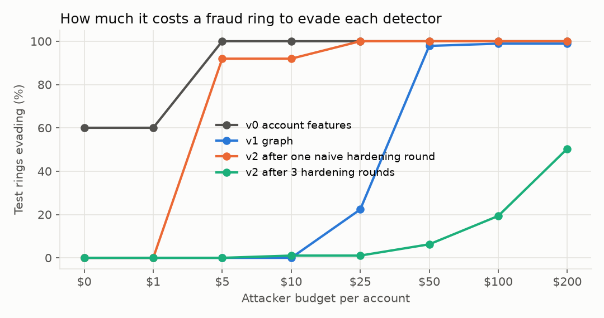

# abuse-graph-redteam-lab

Anti-abuse on an advertiser graph, attacked by an **automated red team**: entity resolution and
graph features catch fraud rings, a budget-aware attacker rewrites the rings to evade them, and
iterated adversarial training raises the attacker's price. Includes distributed connected
components in PySpark and an MCP server that lets an analyst or LLM agent query the graph.

> **All data is simulated**: per world ~24K advertiser accounts (20,000 independent advertisers,
> 60 benign agencies that share offices, cards and devices, and 60 fraud rings run by 25 operators
> who reuse infrastructure). 3 independent worlds. No real Google, advertiser or user data.



## Findings (full tables in [RESULTS.md](RESULTS.md); mean and range over 3 worlds)

| Detector | Rings caught (no attack) | Rings evading at ≤ $25 / account | Median cost to evade |
|---|---:|---:|---:|
| v0: account features only | 40% | 100% | $1 |
| v1: + entity resolution & graph features | **100%** | 22% | $27 |
| v2 after one hardening round | 100% | 100% | $5–8 (a $5 residential proxy) |
| v2 after three red-team / retrain rounds | 100% | **1%** | **$120** |

* Graph features catch every unmodified ring, but the red team breaks them for about $27 per
  account (fresh e-mails, paraphrased ads, prepaid cards, emulated devices).
* **One round of adversarial training only moved the weak spot**: the model shifted onto the IP
  block, and a $5 residential proxy beat it. Three rounds of attack-and-retrain raised the median
  cost to evade to $90–146 per account, and 16–97% of rings could not evade at all.
* Hardening has a price: false positives on benign agencies rose to 4–10% in two of three worlds,
  which is why the false-positive rate is reported next to every detector.
* E-mail entity resolution raised the cost to evade in 2 of 3 worlds and cut agency false
  positives in one (15% → 0.3%).
* Known-bad-neighbour features are built **out of fold**: built naively, every training account
  sees its own ring-mates as known bad and the model fails on new rings.

## How it works

| Path | Contents |
|---|---|
| `agl/sim.py` | Accounts, benign agencies, fraud rings and operators with ground truth |
| `agl/graph.py` | E-mail entity resolution (+tags, gmail dots, digits), MinHash-style ad-text signatures, shared-attribute group statistics, connected-component operator clusters, known-bad propagation |
| `agl/detector.py` | LightGBM; ring/agency-grouped splits; out-of-fold known-bad features; threshold at 1% false positives (out-of-fold) |
| `agl/redteam.py` | 11 priced evasion actions; greedy score-query attacker (most risk reduction per dollar each round); evasion-vs-budget curves; optional `LLMPlanner` that asks an LLM to choose the action (needs an API key; **not used for the results**) |
| `agl/study.py`, `agl/report.py` | v0 / v1 / v2 detectors, attacks on test rings, hardening rounds on training rings only |
| `spark/connected_components.py` | Entity-resolution clusters as distributed connected components (alternating min-label propagation); 239K accounts in 6 iterations, identical to scipy |
| `mcp_server/` | MCP tools `account_risk`, `cluster_summary`, `top_clusters`; cards, devices and e-mails returned only as hashes |

## Run

```bash
pip install -r requirements.txt
pytest -q                                      # 7 tests
python -m agl.study && python -m agl.report    # ~25 min for 3 worlds on 2 cores
python spark/connected_components.py --worlds 10   # needs Java 17+
python -m mcp_server.server                    # stdio MCP server
```

## Limitations

* The attacker queries the detector's risk score (worst case); real operators see only bans.
* The action menu and prices are assumptions; a real red team would discover new actions.
* No web crawling or cloaking detection; no content model of the ad text itself.
* Spark ran on one laptop-class machine; it is slower than scipy at this size and is included to
  show the distributed algorithm, not a speed-up.
